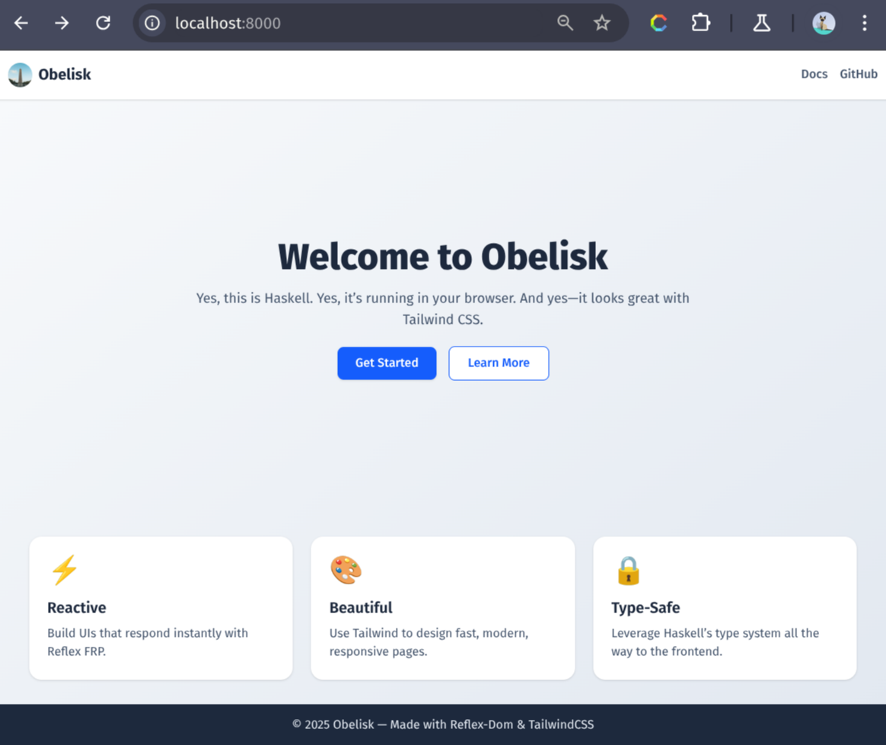

# Obelisk + Tailwind CSS

A Tailwind CSS example using [Obelisk 2.0.0.0](https://github.com/obsidiansystems/obelisk/releases/tag/v2.0.0.0), with a server-rendered Haskell frontend hydrated by WebAssembly.



## Development

Use Linux and Nix with the `nix-command` and `flakes` experimental features enabled. See Obelisk's [setup instructions](https://github.com/obsidiansystems/obelisk/blob/v2.0.0.0/docs/setup.md) for binary-cache configuration.

```bash
nix-shell -A haskell-nix
ob-run
```

Open <http://localhost:8000>. The shell provides the native and WASM compilers, Cabal, Node, the WASI shim, and the Obelisk development scripts.

`ob-run` replaces v1's `ob run`: it rebuilds and restarts the server when Haskell, Cabal, or project files change under `backend/`, `common/`, or `frontend/`. Press Enter to rebuild after changing CSS or other static inputs; static files are not watched automatically. Use `ob-watch` for native typechecking without cross-compiling, or `ob-repl` for GHCi.

To build the production server and its assets:

```bash
nix-build -A haskell-nix.serverExe.wasm
./result/backend --port=8000
```

## Dependency and project configuration

`.obelisk/impl/github.json` pins Obelisk **v2.0.0.0** at commit `313f684b9288094beb0e6b99489fae8f70f1f8ad`. Its recursive fetch includes Obelisk's git submodules. The existing thunk location is retained; the v1 `ob` CLI is no longer used.

`default.nix` imports that pin and evaluates `project.nix`, the v2 Nix module. The module connects the compiled Tailwind assets to Obelisk:

```nix
obelisk.static.path = import ./static { inherit pkgs; };
obelisk.config.path = ./config;
```

Public configuration under `config/common/` and `config/frontend/` is bundled in production. Backend secrets must be provided at runtime, not placed in the Nix store. `config/common/route` is no longer required or read automatically by Obelisk.

The Cabal packages use Obelisk's v2 setup hooks to build the frontend and generate the static manifest. `frontend/wasm/` and `frontend/js/` provide the cross-compiled executable wrappers. WASM is the default; a JS build additionally needs the GHCJS cross toolchain enabled in `project.nix`.

## Tailwind assets

`static/src/css/styles.css` imports Tailwind CSS. `static/default.nix` runs the Tailwind CLI, makes the frontend Haskell source available for class discovery, and produces:

- `styles.css`: the compiled stylesheet.
- `images/`: the example's images.

Tailwind is supplied by the pinned Nix packages in `static/src/nixpkgs.nix`; no node2nix generation step is needed.

Build the assets separately with:

```bash
nix-build static
```

For native Cabal builds, the executable `static/generate` builds this derivation. The `static/generated/custom/` setup hook then generates `Obelisk.Generated.Static`, which the frontend uses to refer to fingerprinted asset URLs. Nix builds generate the same manifest through Obelisk's module integration. Generated manifests and build outputs are not source files to edit.

Reference assets with the v2 typed API, for example `static @"styles.css"` or `static @"images/obelisk.jpg"` from `Obelisk.Generated.Static` (with `TypeApplications` enabled).

## Changes from Obelisk v1

This example now uses the v2 Nix module API, Cabal setup hooks, and WASM entry point instead of reflex-platform, `src-bin` executables, and the `ob` CLI. The old Android/iOS Nix settings are removed: v2 mobile packaging uses Capacitor rather than those options. See the [v2 migration guide](https://github.com/obsidiansystems/obelisk/blob/v2.0.0.0/docs/migrating-to-v2.md) for deployment and mobile migration details.

Thanks to Emre Can for the [photo used in this example](https://www.pexels.com/photo/architectural-photography-of-obelisk-2079658/).
